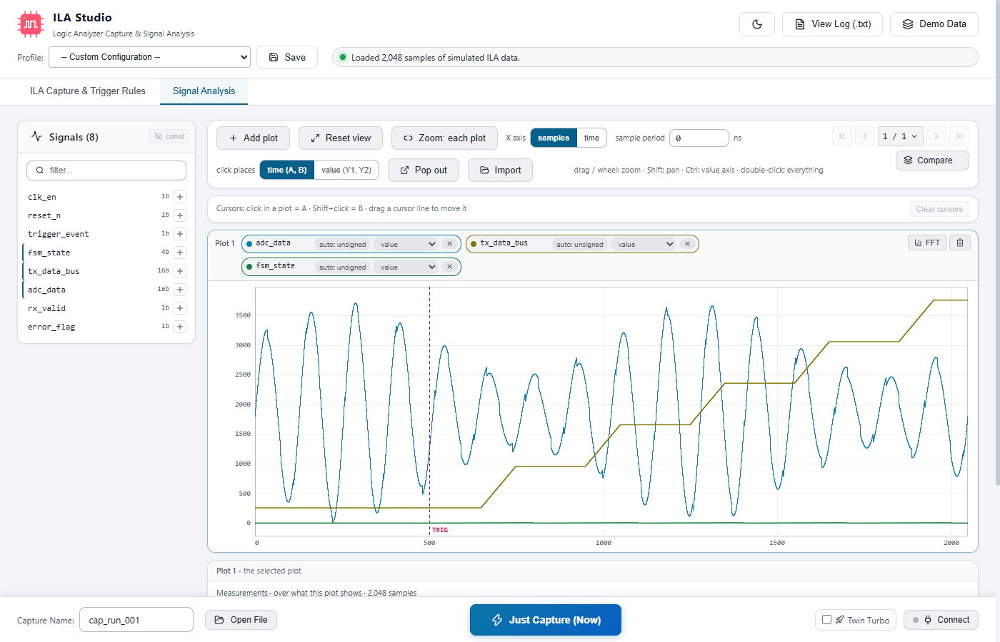
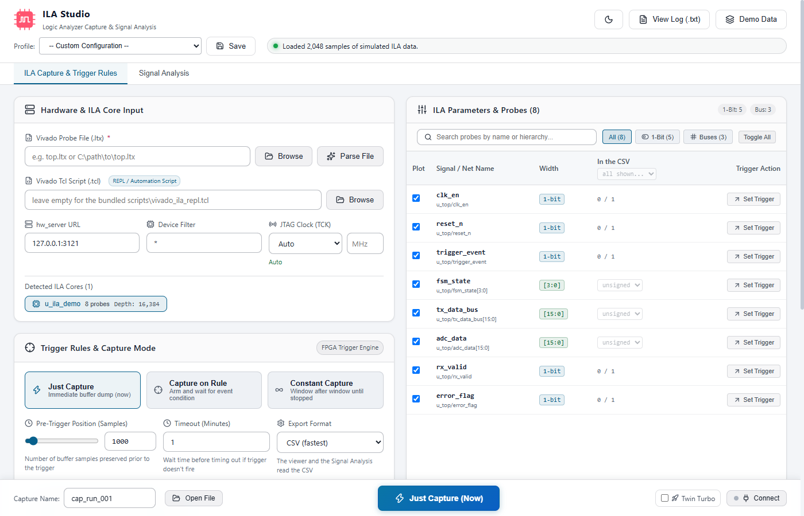

# ILA Studio

ILA Studio is a Windows desktop application for FPGA engineers who debug with the ILA (Integrated Logic
Analyzer) cores of AMD Vivado (formerly Xilinx). It reads the probe file of a design, sets a trigger, takes
single or continuous captures over JTAG, and shows each capture at once in a waveform viewer and in a signal
analysis view with plots, cursors, measurements and spectra. It drives a separately installed Vivado in the
background and needs Python 3; captures are ordinary `.csv` / `.ila` files on disk.



## Status

- Version 0.4.0, the first public release.
- Developed and tested with **Vivado 2017.4**, a **Zynq-7000** device and a **SmartLynq** cable through a remote
  hw_server, on Windows. Other Vivado versions, device families and cables are untested; two differences are
  known and listed under [Known limitations](#known-limitations). Reports are welcome, good or bad.
- Windows 10 and 11 only for now.
- The interface can be tried without any hardware: see [Quick start](#quick-start-without-hardware).

## Not an AMD product

ILA Studio is an independent open-source project. It is not affiliated with, endorsed by or supported by
Advanced Micro Devices, Inc. AMD, Xilinx, Vivado, Vitis, Zynq, MicroBlaze and SmartLynq are trademarks of Advanced Micro Devices,
Inc. and/or its subsidiaries, used here only to describe the tools and hardware this software works with. This
project contains no AMD software: a separately installed and licensed Vivado or Vivado Lab Edition is required
for hardware work.

## Features

- Reads a Vivado probe file (`.ltx`) directly: ILA cores, signal names and widths, without starting Vivado.
  [More](docs/user-guide.md#probe-file-hw_server-and-jtag)
- Three capture modes: at once, on a trigger rule built with a few clicks, or window after window until
  stopped. [More](docs/user-guide.md#trigger-and-capture-modes)
- Keeps the Vivado session open between captures, so only the first one waits for Vivado to start. Two Vivado
  processes can take turns in a continuous capture. [More](docs/user-guide.md#the-hardware-session)
- Sets the JTAG clock by the debug hub clock of the design, and repairs a cable that Vivado can no longer
  connect to ("bad enum default").
- Designs with several ILA cores; a number format (unsigned, signed, hex) for each bus in the CSV.
  [More](docs/user-guide.md#the-probe-list)
- Waveform viewer for logic traces and buses, with zoom, pan and a trigger marker.
  [More](docs/user-guide.md#waveform-viewer)
- Signal Analysis: stacked plots, time and value cursors, measurements, phase and delay between signals, FFT,
  comparison of up to eight captures, a pop-out window. [More](docs/user-guide.md#signal-analysis)
- Profiles: save the whole set-up under a name and get it back. [More](docs/user-guide.md#profiles-and-save)
- A command line for unattended work: repeated captures, continuous recording, captures timed by the
  firmware of the board (hook mode), statistics. [More](docs/user-guide.md#command-line)

## Requirements

To run:

- Windows 10 or 11, with the Microsoft Edge WebView2 Runtime (part of Windows 11; install it from Microsoft on
  a Windows 10 PC that lacks it).
- **Python 3.8 or newer.** Only the standard library is used; there is nothing to `pip install`. The
  application looks for it in this order: the path in the environment variable `ILA_PYTHON`, then `PATH`, then
  `py -3`.
- For hardware work: **Vivado or Vivado Lab Edition**, and a running hw_server that the JTAG cable is attached
  to. Vivado is looked for in this order: `tools.vivado` of the selected profile (without one:
  `C:\Xilinx\Vivado\2017.4\bin\vivado.bat`); `vivado` / `vivado_lab` on `PATH`; the folder in `XILINX_VIVADO`,
  and `Xilinx\Vivado\<version>` or `Xilinx\Vivado_Lab\<version>` on `C:`, `D:` or `E:` - also in the order of
  newer installers, `Xilinx\<version>\Vivado` or `AMDDesignTools\<version>\Vivado` - of which the highest
  version is taken.
- Only for the hook mode of the command line: `xsct` and the GNU `nm` / `objdump` of the target CPU, from
  Vitis or the Xilinx SDK.

To build:

- Node.js 20.19+, 22.13+ or 24+ (the `engines` of `package.json`: what Vite, ESLint and Vitest all accept).
- Rust 1.90 or newer (the `rust-version` of `src-tauri/Cargo.toml`) with the MSVC build tools; see the
  [Tauri prerequisites](https://v2.tauri.app/start/prerequisites/).

## Quick start without hardware

```powershell
git clone https://github.com/AtahanA/ila-studio.git
cd ila-studio
npm ci
npm run tauri dev
```

The first start compiles a few hundred Rust crates and takes several minutes; later starts are much faster.
When the window is up, click **Demo Data** (top right) and open the tab **Signal Analysis**. The demo needs
Python, not Vivado.



## First capture with hardware

1. Make sure hw_server runs where the JTAG cable is attached, and that the bitstream with the ILA is loaded.
2. Under **Vivado Probe File (.ltx)** click **Browse** and pick the probe file of that bitstream. The probes
   appear in the list on the right. If the status line says `Failed to parse LTX` instead, the file is in a
   form that is not read here (see [Known limitations](#known-limitations)): leave the path in the field and
   go on - **Connect** reads the cores and probes from the device.
3. Enter the address under **hw_server URL**: `127.0.0.1:3121` for this PC, otherwise `<host>:3121`. Leave
   **Device Filter** at `*` and **JTAG Clock (TCK)** at `Auto`.
4. Click **Connect** (bottom right). Vivado starts, which takes tens of seconds, and the cores, their depth
   and the probes are read from the device.
5. Choose a mode and press the capture button: **Just Capture** captures at once. For **Capture on Rule**
   click **Set Trigger** on a probe, choose the edge or value, then **Arm & Capture on Trigger**. **Constant
   Capture** runs until **Stop Capture**.
6. The capture appears in the viewer and in **Signal Analysis**, and as a file under `captures\`.
7. **Disconnect** closes Vivado and gives the cable its JTAG clock back. Closing the window does the same.

The [user guide](docs/user-guide.md) describes every control.

## Building the portable folder

```powershell
.\make_distribute.ps1               # release build, then copy everything into distribute\
.\make_distribute.ps1 -NoBuild      # copy only: the Python / Tcl side changed, the executable did not
.\make_distribute.ps1 -AllProfiles  # also copy your own profiles (for a folder that stays on your PC)
```

The build needs the tools listed under Requirements and `npm ci`. `distribute\` then holds `ila-studio.exe`,
`ila_bridge.py`, `ila_capture.py`, `xsct_repl.tcl`, `scripts\vivado_ila_repl.tcl`, `profiles\example-*.json`,
the licence, this file and the documents it links to (`docs\`, `SECURITY.md`, `CONTRIBUTING.md`,
`CHANGELOG.md`). Copy the whole folder to the PC that needs it and start `ila-studio.exe`. The executable must
stay next to the Python scripts, and the folder must be writable, because captures, profiles and the log are
written into it.

There is no installer: the executable drives the Python and Tcl scripts next to it and writes its data
beside them, which an installer does not provide for.

`.\run_gui.ps1` starts `distribute\ila-studio.exe` if it exists, else a local release build, else
`npm run tauri dev`. If PowerShell refuses to run scripts:
`powershell -ExecutionPolicy Bypass -File .\run_gui.ps1`.

## Where data is written

Everything is written next to `ila_bridge.py`: in the repository in a development build, in `distribute\` in a
portable folder.

| What | Where |
|---|---|
| Captures | `captures\<date>_<time>_unit\` with `index.csv` and `session.log` (another folder if the selected profile sets `capture.out`) |
| Saved profiles | `profiles\<name>.json`, with `.json.orig` / `.json.bak` copies of what was there before |
| Log of all hardware jobs | `ila_log.txt` |

All of this is ignored by git; only the two shipped example profiles are tracked. The logs and the saved profiles
contain local paths, the hw_server address and probe names: **read them before you share them.** The page also
remembers its last settings in the WebView storage of the application under `%LOCALAPPDATA%`.

## Crash reports (optional, off by default)

ILA Studio can report its own errors to its developers through [Sentry](https://sentry.io), an error-collecting
service. **Nothing is sent unless you switch this on.** The bug button in the header of the main window opens a
panel with the box **Send crash reports**; the choice is remembered on this PC and is taken back in the same
place.

While it is on, a report is sent when the program runs into an error: an error of the page that nothing caught,
an error while a window is drawn, or a crash (panic) of the backend. A report contains:

- the error text, the kind of error, and where in the program it happened: the stack, which is function
  names, the paths of the program's own source files, line numbers and, for a crash of the backend, addresses
  in its code (for an error while a window is drawn, also the components that were being drawn);
- the time, a random id, the version of ILA Studio and whether it is a release or a development build, the
  version of Windows, the processor architecture (`x86_64`), the Rust version the program was built with, the
  name and version of the reporting library, and which window it was (main or analysis).

It never contains captures, profiles, `ila_log.txt`, the probe file, your settings or what you did before the
error. The name of the PC, which the reporting library would add, is removed.

Before a report leaves, three things are taken out of every text in it: the name of a user folder
(`C:\Users\<name>\...`, `/home/<name>/...`), the server of a network path (`\\server\share\...`) and IPv4
addresses. A text is cut after 2,000 characters. **Other names are not recognised**: an error text can contain
the name of a probe, of a file or a folder, or of a host that is called by its name - whatever the failing step
was working with. That is why crash reports are off by default. Leave them off where such names must not
leave the building.

- **Where reports go.** The panel names the server. A build from source has no report address and cannot send
  ("This build has no address to send reports to."), unless the environment variable `ILA_SENTRY_DSN` held one
  while the program was built.
- **A Sentry of your own.** Set `ILA_SENTRY_DSN` to the DSN of your Sentry project before you start the program:
  reports then go there, and nowhere else. Set to a text that is no DSN (`ILA_SENTRY_DSN=off`), it leaves the
  program without a report address: crash reports cannot be switched on at all.
- **One report by hand.** While crash reports are off, the error screen of a window ("ILA Studio ran into an
  error and cannot show this window.") offers **Send this error report**, which sends that one error. A build
  without a report address has no such button.
- **Send a test report** in the panel sends one report that says only "ILA Studio test report", and shows the id
  it has on the server, or why it did not arrive.

Like any server, the one that receives a report sees the IP address it comes from. A report is sent by the
backend of the program, not by its page, with the TLS of Windows and the certificates Windows trusts; a proxy
named in `ALL_PROXY`, `HTTPS_PROXY` or `HTTP_PROXY` is used.

## Profiles

A profile is a JSON file with the set-up of one board: hw_server, probe file, trigger, capture settings. The
**Save** button writes one; the Profile list applies one. Two examples are in [`profiles/`](profiles/). All
keys are described in [docs/profile-schema.md](docs/profile-schema.md).

## Command line

`ila_capture.py` works without the GUI. Its commands are `check`, `info`, `capture`, `watch`, `hook`,
`convert`, `stats` and `summary`; options such as `--profile` stand before the command.

```powershell
python ila_capture.py --help
python ila_capture.py --profile profiles\example-basic.json check
python ila_bridge.py demo-capture
python ila_capture.py stats captures\demo_ila_*.csv
python ila_capture.py summary captures
```

See the [command line section](docs/user-guide.md#command-line) of the user guide.

## How it is put together

```
GUI (React)  --invoke-->  Rust (async commands, never on the UI thread)
                              |  spawns, reads line by line
                              v
                         ila_bridge.py  --drives-->  ila_capture.py Session
                                                          |  stdin/stdout REPL
                                                          v
                                               vivado -mode tcl  scripts/vivado_ila_repl.tcl
```

- The GUI is a Tauri v2 application: a React 19 / TypeScript page in a WebView and a small Rust backend.
- All hardware work is done by Python (`ila_bridge.py`, `ila_capture.py`), which keeps one Vivado in Tcl mode
  running and sends it one command for each line.
- Only the ILA is touched: the device is never programmed. Stop and closing the window end a job in order, so
  that Vivado exits and the cable gets its JTAG clock back.
  [More](docs/user-guide.md#how-it-is-put-together)

## Troubleshooting

| What you see | Cause | What the tool does / what to do |
|---|---|---|
| `Python 3 was not found. Install Python 3.8 or newer, or set the ILA_PYTHON environment variable to the full path of python.exe.` | No Python 3.8+ on `PATH`. At start it shows as "Could not read the profiles: ...". | Install Python; the next action looks for it again. If it is still not found, restart the application: a running program does not see a `PATH` that an installer has changed. Or set `ILA_PYTHON` before starting the application. |
| `Vivado not found (tools.vivado is ...)` | Vivado is in none of the places that are searched. | Any one of these: put Vivado's `bin` folder on `PATH`; set `XILINX_VIVADO` to the installation folder; install under `Xilinx\Vivado` on `C:`, `D:` or `E:`; write the full path of `vivado.bat` as `tools.vivado` into a profile. |
| `Failed to parse LTX: not well-formed (invalid token): line 1, column 0` | The probe file is in the JSON form (it begins with `{ "ltx_root"`); only the XML form, as Vivado 2017.4 writes it, is read without Vivado. | Leave the path in the field and click **Connect**, which reads the cores and probes from the device. If the core then stays IDLE, set the JTAG clock by hand (hub clock / 2.5 or lower). |
| `ila_bridge.py was not found in ...` | The executable was copied without the scripts. | Keep `ila-studio.exe` in the folder that `make_distribute.ps1` made. |
| `hw_server at ... is not reachable` | Wrong address, network, cable off. | Checked in 3 s before Vivado is started. Check the address and the cable. |
| `[Common 17-70] Application Exception: bad enum default`, then no hardware targets | The cable runs at a TCK frequency Vivado cannot represent (a SmartLynq asked for 6 MHz reports 6034482 Hz), left behind by an earlier session while another client (e.g. an SDK debug session) kept the cable open. | Detected and repaired automatically (xsdb puts the cable back to 10 MHz, then the connect is retried). Every session also restores the cable's frequency when it ends. Seen in ANOTHER Vivado while ILA Studio is connected: click Disconnect here first. |
| `the ILA core does not run: it is still IDLE after being armed` | TCK too fast for the debug hub clock, or the ILA clock is stopped. In a session that has been open for a while: another program has changed the cable's JTAG clock. | Use `Auto` (or a frequency at or below hub clock / 2.5). A kept session reconnects by itself and tries the capture once more; otherwise Disconnect and Connect. |
| `no ILA core found on ...: Vivado sees the device but no debug hub in it` | The FPGA is not configured yet (right after power-up), its debug hub clock is not running, or the bitstream has no ILA / the `.ltx` belongs to another build. | Wait for the board to boot, load the matching bitstream / pick the matching `.ltx`. |
| `the JTAG chain is empty` | The cable answers but sees no device. | Power the board. |
| `probe X is not a probe of the selected ILA core (...): it belongs to core N ...` | The trigger names a probe of another ILA core of the design. | Select that core (chips under "Detected ILA Cores"), or choose a trigger probe of the selected core. |
| `The Tcl script ... is older than this program` | The program was updated without its `scripts` folder, or the "Vivado Tcl Script" field names a copy from an earlier release. | Update the whole folder; clear the Tcl script field, and `tools.tcl_script` of the selected profile, which is used while the field is empty. |
| `not triggered within N min` | The trigger condition did not occur. | Raise the timeout or check the condition with a `Just Capture`. |

## Known limitations

- Windows only. The code has paths for Linux, but they have never been run.
- Tested with one Vivado version, one device family and one kind of cable (see [Status](#status)).
- A probe file in the JSON form that Vivado can also write (it begins with `{ "ltx_root"`) is not read by
  **Browse** / **Parse File** (`Failed to parse LTX`); only the XML form of Vivado 2017.4 is. The debug hub
  clock of such a file is not read either, so `Auto` does not lower the JTAG clock for that design: choose a
  frequency at or below hub clock / 2.5 yourself. **Connect** still lists the cores and probes.
- The search for a Vivado in the folder order of newer installers (`Xilinx\<version>\Vivado`) is written from
  the layout of such an installation and has not been run against one.
- The last changes before this release (how addresses, paths and triggers are written into the Tcl commands
  for Vivado) were checked against a Tcl interpreter and by the tests, not yet against Vivado itself.
- Untested: a program folder or a user profile whose path has spaces or non-ASCII characters. Not supported:
  `&`, `%` or quotes in the path of the program folder or of a tool.
- A profile and a custom Tcl script are run as code: use only those you trust. See [SECURITY.md](SECURITY.md).
- No installer, and the executables are not signed.
- Hook mode exists on the command line only.

## Contributing, security, changes

[CONTRIBUTING.md](CONTRIBUTING.md) says how to report a problem, how to build and which checks to run.
[SECURITY.md](SECURITY.md) says what is trusted and how to report a vulnerability in private.
[CHANGELOG.md](CHANGELOG.md) lists what changed in each version.

## Licence

Copyright (C) 2026 Atahan Aggunlu

This program is free software: you can redistribute it and/or modify it under the terms of the GNU General
Public License as published by the Free Software Foundation, either version 3 of the License, or (at your
option) any later version.

This program is distributed in the hope that it will be useful, but WITHOUT ANY WARRANTY; without even the
implied warranty of MERCHANTABILITY or FITNESS FOR A PARTICULAR PURPOSE. See the GNU General Public License
for more details. The full text is in [LICENSE](LICENSE) (SPDX: `GPL-3.0-or-later`).

In plain words: you are free to use, study, change and share this software. Whoever passes it on, changed or
unchanged, as source or as a built program, must do so under the same licence and make the corresponding
source available. The software comes without warranty, and it drives
live hardware: it changes the JTAG clock of a cable and, in hook mode, halts and resumes a CPU. You use it at
your own risk.

## Third-party software

ILA Studio is built with [Tauri](https://tauri.app), [React](https://react.dev), [Vite](https://vite.dev),
[Lucide](https://lucide.dev) icons and, for the crash reports, the
[Sentry SDK for Rust](https://github.com/getsentry/sentry-rust). Their licences, and those of the libraries they
bring along, apply to binary distributions: every release archive holds `THIRD-PARTY-NOTICES.md`, which lists
them with their licence texts. `python tools/third_party_notices.py` writes that file; see the release
checklist in [CONTRIBUTING.md](CONTRIBUTING.md#release-checklist).
